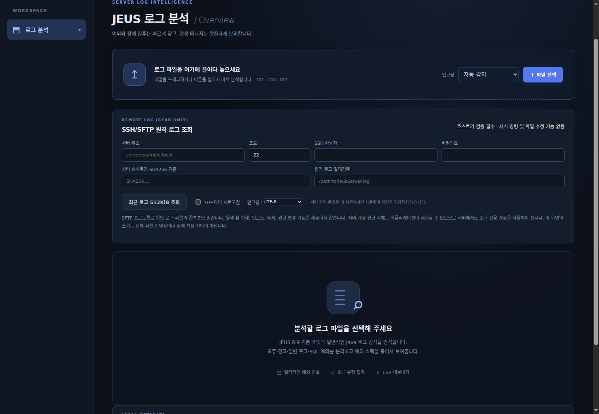
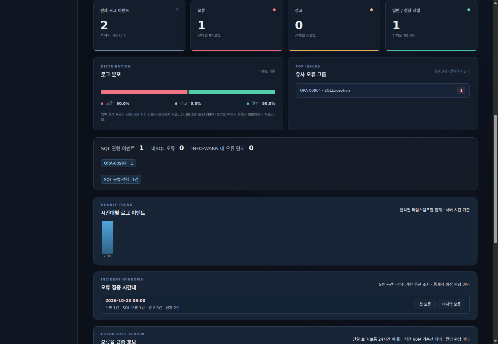
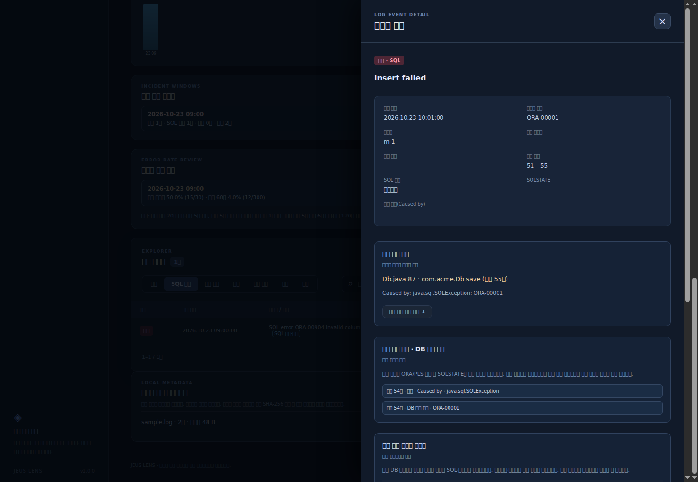
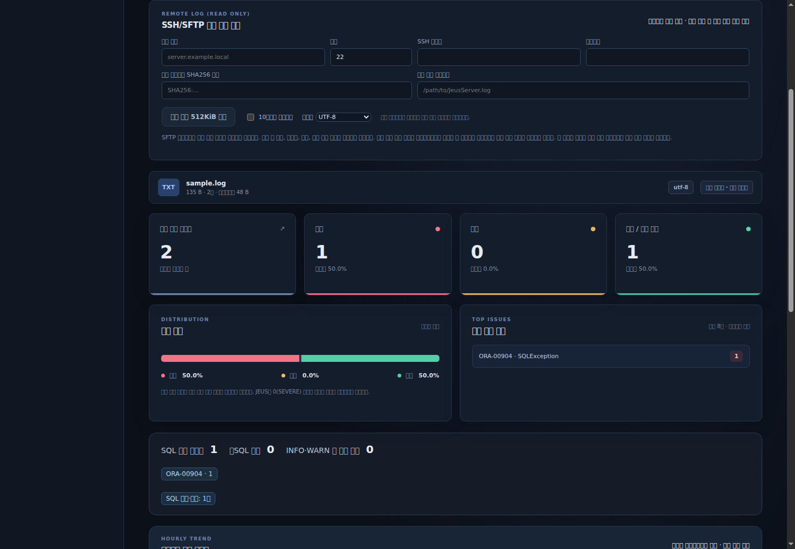

# JEUS Lens

**JEUS 로그 분석 도구 · v1.0.2 · Windows x64**

JEUS/Java 서버 로그에서 예외, Oracle SQL 오류, 발생 시각 및 관련 로그를 찾아보는 로컬 분석 프로그램입니다. 로그 원본은 파일로 복사 저장하지 않고, 검색과 분석에 필요한 메타데이터만 보관합니다.

[**최신 정식 릴리즈 다운로드**](https://github.com/P-JSL/JeusLogAnalyzer/releases/latest) · [v1.0.2 릴리즈](https://github.com/P-JSL/JeusLogAnalyzer/releases/tag/v1.0.2)

**Windows 실행 파일은 Go 원본판과 Rust 백엔드판으로 구분됩니다.** Rust판은 기존 웹 화면을 그대로 내장하되 로그 분석 서버를 Rust로 독립 구현한 버전입니다. 두 파일은 릴리즈의 파일명에서 `Rust` 포함 여부로 구분할 수 있습니다.

## 주요 기능

| 기능 | 설명 |
|---|---|
| 로그 분석 | JEUS 8/9·일반 Java 로그, 멀티라인 스택 트레이스, UTF-8/CP949/UTF-16 |
| 오류 분류 | ERROR/WARN/INFO, SQL 예외, 비SQL 오류, INFO/WARN 내 오류 **검토 후보** |
| 상세 진단 | Java `Caused by`, 오류 코드(`ORA-`, `PLS-`, `SQLSTATE`), 스택 위치, SQL·바인드값 및 원본 행 |
| 탐색 | 원문 검색, 필터, 유사 오류 그룹, 같은 요청 ID의 로그 찾기 |
| 통계 | 시간대별 이벤트, 5분 오류 집중 구간, 이전 60분 대비 오류율 급증 후보 |
| 추가 기능 | SSH/SFTP 실시간 연결 진단·최근 로그 조회, 검증 기반 자동 업데이트, CSV/JSON·진단 요약 및 분석 이력 |

> 화면 이미지는 **합성 테스트 로그를 사용해 실제 Chromium에서 캡처한 예시**입니다. 로그의 오류 여부와 원인은 규칙 기반 진단 결과이며, 서버 장애나 근본 원인을 자동 확정하지 않습니다.

## 1. 설치 및 실행

1. [Releases](https://github.com/P-JSL/JeusLogAnalyzer/releases/tag/v1.0.2)에서 Go판 `JEUS_Lens_Windows_x64_v1.0.2.zip` 또는 Rust판 `JEUS_Lens_Rust_Windows_x64_v1.0.2.zip`을 선택해 다운로드하고 압축을 풉니다. 각 EXE를 개별 다운로드해도 됩니다.
2. **선택한 ZIP 내부의 EXE를 실행**합니다. 기본 브라우저에서 로컬 주소 `http://127.0.0.1:<임의 포트>/`가 열립니다.
3. 로그 파일을 선택하면 별도 Java/Python 설치 없이 분석할 수 있습니다.

EXE는 **코드 서명되지 않았습니다.** 출처와 SHA-256 체크섬을 확인하고 회사의 보안 정책에 따라 실행하세요. Windows 실기 환경에 대한 별도 검증은 아직 완료되지 않았습니다.

## 2. 로그 파일 가져오기

1. 상단 **인코딩**을 `자동 감지`로 두거나 필요한 경우 `UTF-8`, `EUC-KR / CP949`로 변경합니다.
2. **파일 선택**을 누르거나, 로그 파일을 점선 영역으로 드래그 앤 드롭합니다.
3. 진행률 표시가 완료되면 요약·차트·로그 이벤트 목록이 자동으로 표시됩니다.
4. 다른 파일을 분석할 때는 **새 분석**을 선택합니다.

**지원 범위:** TXT/LOG/OUT/TRACE 등 텍스트 로그, 파일당 최대 **1GiB**, 한 번에 **1개 파일**입니다. ZIP 자체는 분석 대상으로 선택하지 말고 **압축을 풀어 실제 로그 파일을 선택**하세요.

## 3. 결과 화면 해석

| 화면 영역 | 확인할 내용 |
|---|---|
| **전체 로그 이벤트 / 오류 / 경고 / 일반** | 분석된 이벤트 건수와 명시적 로그 레벨별 집계 |
| **로그 분포 / 유사 오류 그룹** | 오류 비율과 반복된 예외·SQL 코드를 확인. 그룹을 클릭하면 해당 이벤트로 필터링 |
| **SQL 관련 이벤트 / 비SQL 오류 / INFO·WARN 내 오류 단서** | SQL 관련 여부 및 오류 레벨이 아닌 로그에 남은 조사 대상 |
| **시간대별 로그 이벤트** | 타임스탬프가 인식된 로그의 시간 구간별 발생량 |
| **오류 집중 시간대** | 5분 단위로 오류가 많이 기록된 구간. **첫 오류 / 마지막 오류**로 실제 이벤트 열기 |
| **오류율 급증 후보** | 직전 60분과 비교한 조사 후보. 충분한 기준 데이터가 없으면 나타나지 않음 |

**주의:** `일반` 또는 `INFO`로 기록됐다고 시스템 정상 상태가 보장되는 것은 아닙니다. 급증 후보의 오류율은 **로그 이벤트 기준**이며 실제 요청 실패율이 아닙니다.

## 4. 오류 검색 및 상세 분석

**로그 이벤트** 영역에서 다음 순서로 조사합니다.

1. **전체 / SQL 예외 / 기타 오류 / 오류 / 검토 후보 / 경고 / 일반** 탭 중 조사할 범위를 선택합니다.
2. SQL 예외 탭에서는 **문법·객체, 제약조건, 연결, 타임아웃, 잠금·동시성, 자원, 권한** 등 세부 유형으로 좁힙니다.
3. 검색창에 `ORA-00904`, `SQLException`, `LOT_ID`, `EQUIPMENT_ID`, SQL 구문 또는 로그에 기록된 특정 문자열을 입력합니다. 필요하면 **대소문자 구분**을 선택합니다.
4. 결과 행을 클릭하여 **이벤트 상세**를 엽니다. 발생 시각, 메시지 코드, 스레드, 요청 식별자, 원본 행을 확인합니다.
5. **오류 발생 위치**와 **예외 전파 경로 · DB 오류 코드**에서 Java 스택, `Caused by`, `ORA-`/`PLS-` 및 `SQLSTATE`를 확인합니다. 근거 항목이나 **원본 오류 줄로 이동**을 누르면 해당 원문 행으로 이동합니다.
6. **오류 당시 기록된 데이터**에서 실제 로그에 남은 SQL·바인드값을 확인하고, **주변 이벤트**를 비교합니다. 요청 ID가 있으면 **동일 요청 식별자 로그 검색**으로 관련 문자열을 다시 탐색합니다.

**예시:** `ORA-00904`는 SQL 문법·객체와 관련된 조사를 시작할 단서입니다. 실제 문제 컬럼, SQL 실행 권한, 배포된 매퍼 등은 출력된 SQL 및 서버 설정과 함께 확인해야 합니다.

원본 전체 검색은 현재 선택한 로컬 파일을 기준으로 수행합니다. 목록 미리보기는 이벤트당 **128KiB**, 선택한 상세 이벤트는 최대 **8MiB**까지 표시합니다. 로그에 기록되지 않은 DB 데이터나 실제 원인을 만들어 내지는 않습니다.

## 5. SSH/SFTP 원격 로그 읽기

서버에 연결할 때는 아래 항목을 입력합니다.

| 입력 항목 | 입력 방법 |
|---|---|
| **서버 주소 / 포트** | SSH 서버 주소 또는 IP, 포트(기본 22) |
| **SSH 사용자 / 비밀번호** | 서버에서 발급한 **읽기 전용 SFTP 계정** |
| **서버 호스트키 SHA256 지문** | 서버 관리자에게 별도 경로로 확인한 `SHA256:...` 지문 |
| **원격 로그 절대경로** | 예: `/logs/server.log` — 실제 서버의 로그 파일 경로 |
| **인코딩** | `UTF-8` 또는 `CP949/EUC-KR` |

1. 필수 정보를 입력한 다음 **SSH/SFTP 연결 및 조회**를 누릅니다.
2. **연결 진단 로그** 탭에서 연결 시작 → TCP·SSH 접속 → 서버 호스트키 확인 → 사용자 인증 → SFTP 개설 → 파일 검증 → 최근 로그 읽기 → 종료가 **실시간으로 순서대로** 표시됩니다. 실패 시에는 오류 코드, 원인 및 확인할 설정이 표시됩니다.
3. **원격 로그 내용** 탭에서 마지막 최대 512KiB의 로그 내용을 확인합니다.
4. 진행 중 **연결 중단**을 누르면 현재 조회가 취소됩니다. **다시 조회**는 새 SSH/SFTP 연결로 읽기를 재시도합니다. 매 조회마다 연결을 열고 종료하며 연결을 계속 유지하지 않습니다.
5. **10초마다 새로고침**을 선택하면 새 연결로 주기적으로 조회하며, 연결 오류 시 해제됩니다. 진단 기록은 현재 브라우저에만 남으며 **진단 로그 복사 / 기록 지우기**가 가능합니다.

이 기능은 **원격 파일의 끝부분 미리보기**이며, 원격 전체 로그를 자동으로 내려받거나 전체 인덱스를 만드는 기능은 아닙니다. 프로그램은 원격 명령 실행·파일 업로드·수정·삭제 기능을 제공하지 않지만, **서버 계정의 기존 권한을 변경하지는 못합니다.** 반드시 서버 측에서도 읽기 전용 권한을 설정해야 합니다. 비밀번호는 로컬 설정 파일에 저장하지 않습니다.

## 6. 자동 업데이트

1. **자동 업데이트 · GitHub Releases**에서 **새 버전 확인**을 누릅니다. 앱은 시작할 때와 사용자가 허용한 경우 **30분마다 새 정식 릴리즈를 자동 확인**합니다.
2. 저장소가 Private인 경우 해당 저장소에 **Contents: Read** 권한이 있는 GitHub Fine-grained Personal Access Token을 입력합니다. 공개로 전환된 저장소에는 토큰이 필요하지 않습니다.
3. 신규 버전이 나타나면 **검증 후 자동 설치·재실행**을 누릅니다. 또는 **새 버전 발견 시 자동 설치**를 명시적으로 선택해 자동 설치를 활성화합니다.
4. 다운로드된 새 Windows 실행 파일은 GitHub 릴리즈에 기록된 **SHA-256 및 파일 크기**를 확인하고, 현재 프로그램이 종료된 다음 교체하고 다시 시작합니다. 업데이트 과정에 실패하면 가능한 한 기존 EXE를 복원합니다.

**보안 및 제약:** 자동 설치는 Windows x64 EXE에서만 동작하며 실행 파일을 둔 디렉터리에 쓰기 권한이 필요합니다. 인증 토큰은 파일·설정·진단 로그·교체 스크립트에 저장하지 않으며 현재 브라우저 세션에서만 사용합니다. Private 저장소에서는 다음 실행 시 다시 토큰이 필요할 수 있습니다. EXE는 코드 서명되지 않았으므로 실행 전 조직 보안 정책을 확인하십시오.

## 7. 결과 내보내기 및 분석 이력

**결과 내보내기:** 로그 이벤트 목록 위에서 **진단 요약**, **CSV 내보내기**, **JSON**을 선택합니다. CSV/JSON은 현재 필터·검색 결과 기준 **최대 5,000건**이며, **원문 포함**은 기본 해제 상태입니다. 원문을 포함하려면 직접 체크하고 경고를 확인해야 합니다. 메시지 자동 마스킹은 모든 민감정보를 완벽히 제거하지 못하므로 배포 전에 파일을 점검하세요.

**기존 분석 다시 열기:** 화면 아래 **저장된 분석 메타데이터**에서 원하는 이력의 **원본 연결**을 누르고 **동일한 원본 로그 파일**을 선택합니다. 파일의 SHA-256이 일치하면 저장된 분석 인덱스를 재사용합니다. **삭제**는 분석 메타데이터만 삭제하며 원본 로그를 삭제하지 않습니다. 이전 버전에서 생성한 이력에는 새로운 분석 항목이 없을 수 있으므로 필요한 경우 재분석하세요.

## 사용 시 알아둘 사항

- 분석과 검색은 **이 PC의 로컬 프로그램**에서 처리합니다. 원본 파일의 디스크 사본은 남기지 않지만 파일명·SHA-256·집계·오프셋 등 **분석 메타데이터는 저장**됩니다.
- 실제 운영 로그에는 SQL 바인드값, 토큰, 업무 식별자 및 개인정보가 있을 수 있습니다. 로그나 분석 결과를 공개 저장소에 올리지 마세요.
- 로그 형식에 따라 메시지/타임스탬프 인식이 달라질 수 있으며, 운영 서버 SSH/SFTP 연결 및 Windows 실기 호환성은 환경별 검증이 필요합니다.
- 이 도구는 JEUS 제조사의 공식 인증 제품이 아닙니다.

개발 및 보안 관련 문서: [아키텍처](docs/ARCHITECTURE.md) · [보안](SECURITY.md) · [검증 범위](REVIEW.md) · [v1.0.2 릴리즈 노트](RELEASE_NOTES_v1.0.2.md)
